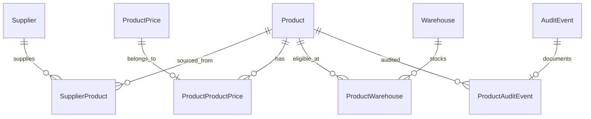
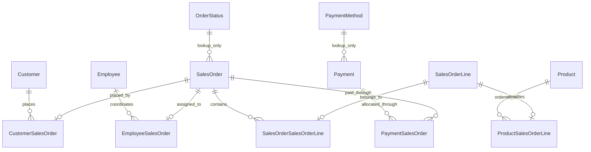
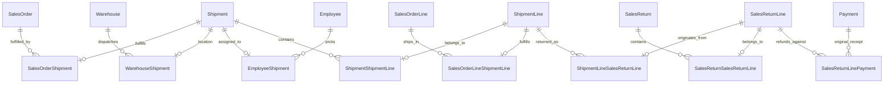
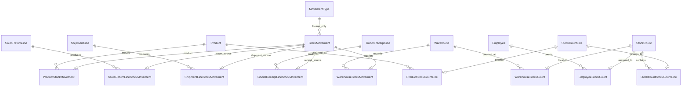

# ProductSalesInventory relationship diagrams

The [dictionary](ProductSalesInventory_DataDictionary.md) lists every column and bridge constraint; the [bridge DDL](ProductSalesInventory_Bridges.sql) is authoritative.

Every box with two entity IDs is an actual bridge table. Entities have single identity primary keys; bridges have composite primary keys. `||--o|` on a child side depicts the database's maximum-one bridge participation, not automatic required participation. Required rows are created atomically and checked separately. No diagram implies a hidden direct entity FK.

## Catalog, locations and product history

`ProductAuditEvent` is in the `audit` schema; the other bridges are in `rel`. AuditEvent stores immutable snapshots and execution context. Historical line prices remain on the line entities rather than being recalculated from ProductPrice.

## Sales and payment allocation

PaymentSalesOrder carries AllocatedAmount. An order can have several payments and a payment can cover several orders. Staff assignment is optional where the original demand source does not identify a responsible employee.

## Purchasing and receiving

```mermaid
erDiagram
    Supplier ||--o{ SupplierPurchaseOrder : receives
    PurchaseOrder ||--o| SupplierPurchaseOrder : ordered_from
    Employee ||--o{ EmployeePurchaseOrder : buys
    PurchaseOrder ||--o| EmployeePurchaseOrder : assigned_to
    PurchaseOrder ||--o{ PurchaseOrderPurchaseOrderLine : contains
    PurchaseOrderLine ||--o| PurchaseOrderPurchaseOrderLine : belongs_to
    Product ||--o{ ProductPurchaseOrderLine : purchased_as
    PurchaseOrderLine ||--o| ProductPurchaseOrderLine : identifies
    PurchaseOrderLine ||--o{ PurchaseOrderLineGoodsReceiptLine : received_in
    GoodsReceiptLine ||--o| PurchaseOrderLineGoodsReceiptLine : fulfills
    GoodsReceipt ||--o{ GoodsReceiptGoodsReceiptLine : contains
    GoodsReceiptLine ||--o| GoodsReceiptGoodsReceiptLine : belongs_to
    Warehouse ||--o{ WarehouseGoodsReceipt : receives_at
    GoodsReceipt ||--o| WarehouseGoodsReceipt : location
    Employee ||--o{ EmployeeGoodsReceipt : receives
    GoodsReceipt ||--o| EmployeeGoodsReceipt : checked_by
```

A purchase line may be received in multiple receipt lines. Quantity reconciliation is not inferred solely from the presence of bridges.

## Fulfillment and returns

SalesReturnLine.RefundAmount is the actual refunded amount in the seeded scenarios. Its payment bridge carries RefundedAmount and identifies the original payment; Payment.Amount remains the original incoming cash amount. Net receipts subtract refunds.

## Inventory ledger and physical counts

A baseline movement has exactly one of the three typed source relationships. Its product and warehouse must agree with the source document. The movement sign must agree with MovementType.Direction. These invariants are verified by the setup checks; separate FK constraints alone cannot enforce exclusivity across three different bridges.

The three direct lookup arrows in these diagrams are the only exceptions to the all-bridges entity relationship rule.
