# UniversityAdvancedSPBestPractice - Entity Relationship Diagram

ERD for [advanced-sp-cheatsheet-bestpractice-setup.sql](./advanced-sp-cheatsheet-bestpractice-setup.sql).
Every relationship between core entities flows through an explicit
many-to-many junction table.

```mermaid
erDiagram
    Departments {
        int DepartmentID PK "IDENTITY"
        nvarchar(100) DepartmentName UK
    }

    Advisors {
        int AdvisorID PK "IDENTITY"
        nvarchar(100) AdvisorName
    }

    Students {
        int StudentID PK "IDENTITY"
        nvarchar(50) FirstName
        nvarchar(50) LastName
        nvarchar(100) Major "NULL"
    }

    Courses {
        int CourseID PK "IDENTITY"
        varchar(20) CourseCode UK
        nvarchar(100) CourseName
        tinyint Credits
    }

    AdvisorsForDepartments {
        int DepartmentID PK, FK
        int AdvisorID PK, FK
    }

    StudentsOfAdvisors {
        int AdvisorID PK, FK
        int StudentID PK, FK
    }

    StudentsInDepartments {
        int StudentID PK, FK
        int DepartmentID PK, FK
    }

    CoursesByDepartment {
        int DepartmentID PK, FK
        int CourseID PK, FK
    }

    Enrollments {
        varchar(20) Semester PK "e.g. 2026-Fall"
        int CourseID PK, FK
        int StudentID PK, FK
        datetime2 EnrolledAtUtc "DEFAULT SYSUTCDATETIME()"
    }

    StudentAudit {
        int StudentAuditID PK "IDENTITY"
        int StudentID FK
        nvarchar(50) ActionType
        datetime2 ChangedAtUtc "DEFAULT SYSUTCDATETIME()"
    }

    ProcedureDiagnostics {
        int ProcedureDiagnosticID PK "IDENTITY"
        uniqueidentifier CorrelationID
        nvarchar(256) ProcedureName
        int StatusCode
        int ErrorNumber "NULL"
        nvarchar(4000) ErrorMessage "NULL"
        datetime2 LoggedAtUtc "DEFAULT SYSUTCDATETIME()"
    }

    %% Departments <-> Advisors (many-to-many)
    Departments ||--o{ AdvisorsForDepartments : "has"
    Advisors    ||--o{ AdvisorsForDepartments : "serves"

    %% Advisors <-> Students (many-to-many)
    Advisors ||--o{ StudentsOfAdvisors : "advises"
    Students ||--o{ StudentsOfAdvisors : "advised by"

    %% Students <-> Departments (many-to-many)
    Students ||--o{ StudentsInDepartments : "member of"
    Departments ||--o{ StudentsInDepartments : "has"

    %% Departments <-> Courses (many-to-many)
    Departments ||--o{ CoursesByDepartment : "offers"
    Courses     ||--o{ CoursesByDepartment : "offered by"

    %% Students <-> Courses, keyed by Semester (many-to-many)
    Students ||--o{ Enrollments : "enrolls in"
    Courses  ||--o{ Enrollments : "enrolled by"

    %% Audit log
    Students ||--o{ StudentAudit : "audited by"
```

## Notes

- **Junction tables** use composite primary keys made of the participating
  foreign keys (`AdvisorsForDepartments`, `StudentsOfAdvisors`,
  `CoursesByDepartment`).
- **Enrollments** adds `Semester` to its composite key
  (`Semester, CourseID, StudentID`), so a student may retake the same course
  in a different semester.
- **ProcedureDiagnostics** is a standalone error/status log with no foreign
  keys — procedures correlate rows via `CorrelationID`.
